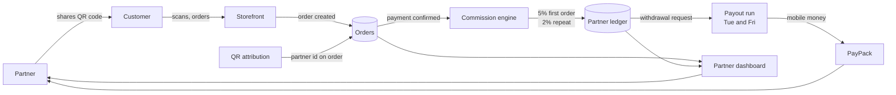

# AFM Independent Sales Program platform

A partner sales network for African Fresh Market, built and run in production. Partners onboard with a QR code, sell to their own network, and are paid commission on a fixed schedule. This repository documents the architecture and the results. The application code is private.

## The problem

A food commerce business in Kigali needed distribution without hiring a sales team. Word of mouth existed, but there was no way to attribute a customer to the person who brought them, no way to pay commission accurately, and no way to show a partner how they were doing.

## What was built

- *Partner onboarding with QR attribution*: every partner gets a unique QR code and short link, so a customer who scans is tied to that partner without typing anything.
- *Commission engine*: 5 percent on a customer's first paid order and 2 percent on every order after, calculated only on verified payments, never on pending ones.
- *Partner dashboard*: sales, customers brought in, rank, points, and withdrawal history in one view.
- *Payouts*: mobile money disbursement through PayPack on twice weekly windows, with a minimum withdrawal and a funding check before each run.
- *Rank and incentive ladder*: tiers with monthly stipends and transport allowances, so partners have a reason to keep selling.
- *Enablement output*: automated QR flyers per partner, a public training channel, and fortnightly training sessions.

## How it fits together

## Results

- 22 registered partners, 5 paid
- RWF 213,000 in partner generated revenue in the first cycle
- 3 paid partner orders in the best week
- Top partner generated RWF 94,000 from two paid orders

## Design decisions worth noting

- *Paid orders only*: every metric counts orders with verified payment. Counting intent inflates dashboards and destroys trust with partners.
- *Attribution at the QR level*, not the account level, so a partner keeps credit even when the customer orders again months later.
- *Payout windows*, not instant payouts, so the business can fund the account before disbursement and reconciliation stays clean.
- *Boring technology on purpose*: the platform runs on managed backend entities and functions rather than a bespoke stack, because a small team has to operate it.

## Stack

React, JavaScript, PostgreSQL backed entities, serverless backend functions, PayPack mobile money API, Meta and WhatsApp Business APIs

## Author

Chijioke Ugorji Kalu, Chief Technology Officer, African Fresh Market

---

*Proprietary. Copyright (c) 2026 Chijioke Ugorji Kalu. All rights reserved. Shared for review only.*
